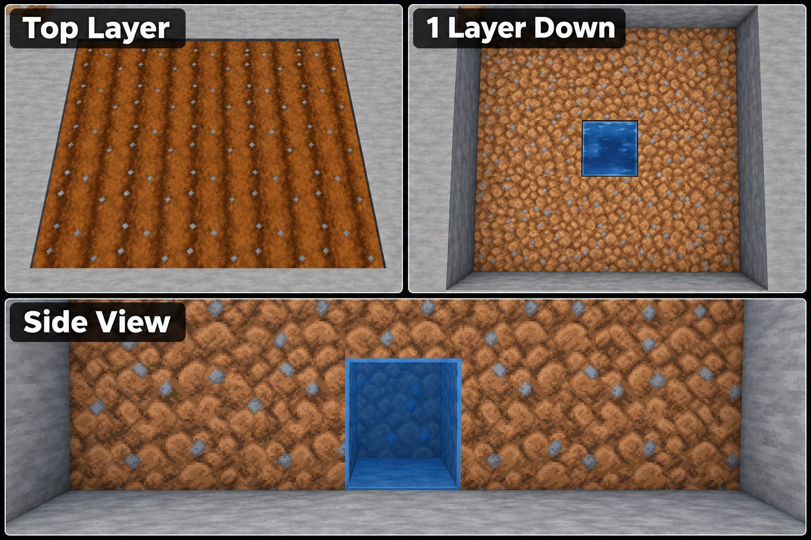

# Watered Roots

A small Fabric mod for Minecraft 26.3 that lets underground water keep farmland
hydrated.

Vanilla watering still works normally. Water beside farmland continues to
hydrate it up to four blocks away. This mod additionally checks for water one
block below the farmland and up to two blocks horizontally in every direction,
giving each underground water block a 5x5 watering area.

Sugar cane works the same way. In vanilla, sugar cane needs water directly beside
the block it is planted on. With this mod, water one block below that block, up
to two blocks horizontally in every direction, also keeps the sugar cane alive.
Water beside the block still works as it does in vanilla.

Because the check uses Minecraft's water fluid tag, waterlogged blocks in that
underground 5x5 area also work. Hydration timing and crop growth speed remain
unchanged from vanilla.

## How It Works

One water block underground hydrates the 5x5 area of farmland directly above
and around it.



Vanilla water placed beside farmland continues to work normally.

## Build

Requires Java 25.

On Windows PowerShell:

```powershell
.\gradlew.bat build
```

The playable mod is created in `build/libs/`. Use the JAR whose name does not
contain `sources`.
